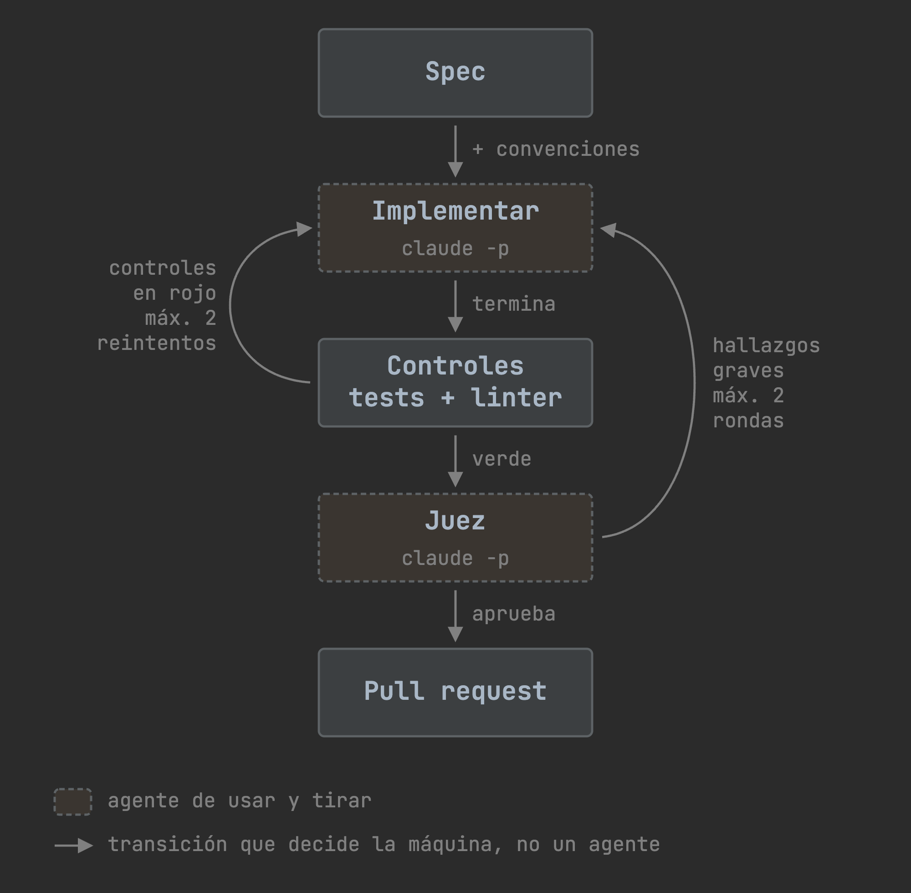

# slice-runner


## Qué es

`slice-runner` convierte una feature troceada en slices en pull requests, sin que tengas que estar
delante. No es un agente que decide qué hacer: es una máquina de estados determinista que marca el
flujo y llama a los agentes por debajo, con `claude -p`, como funciones de usar y tirar. Un agente
implementa, el programa ejecuta los tests y el linter, otro agente distinto juzga el resultado, y el
programa abre la pull request y para. **El merge lo decides tú.**

## Cómo funciona



Si los controles fallan o el juez encuentra hallazgos graves, la slice vuelve a implementarse, con un
tope de dos vueltas en cada caso. Las flechas las decide el programa, no un agente.

## Instalación

Necesitas `uv`, `gh` autenticado, `claude` (Claude Code) y su plugin `superpowers`.

```bash
curl -fsSL https://github.com/alcaptar/slice-runner/releases/latest/download/install.sh | sh
slice-runner doctor
```

Para actualizar: `slice-runner update`.

## Uso

```bash
slice-runner tui
```

Abre un espacio de trabajo con Claude a la izquierda, donde troceas la idea con `/slice-spec`, y el
tablero de slices a la derecha, como en la animación de arriba.

## Qué hace en tu repo sin preguntar

El agente que implementa corre con permisos completos: escribe y borra ficheros, ejecuta comandos, crea
ramas, commitea, empuja y abre pull requests. Nunca mergea ni hace rollback.
